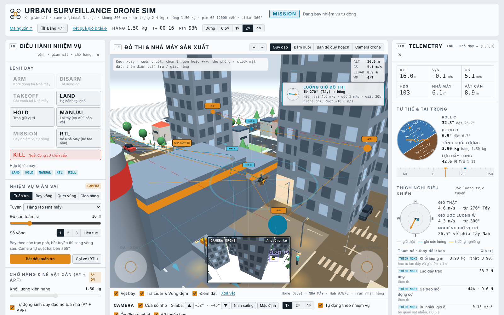
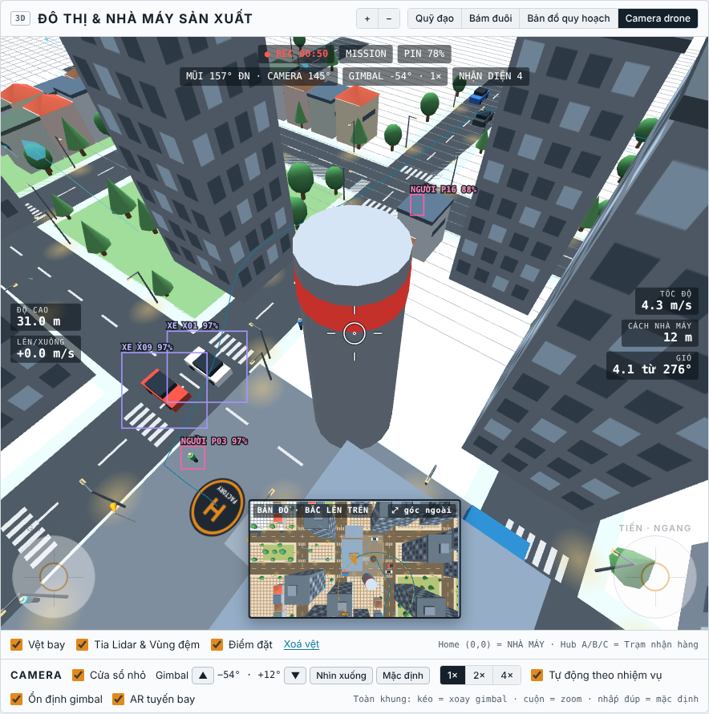
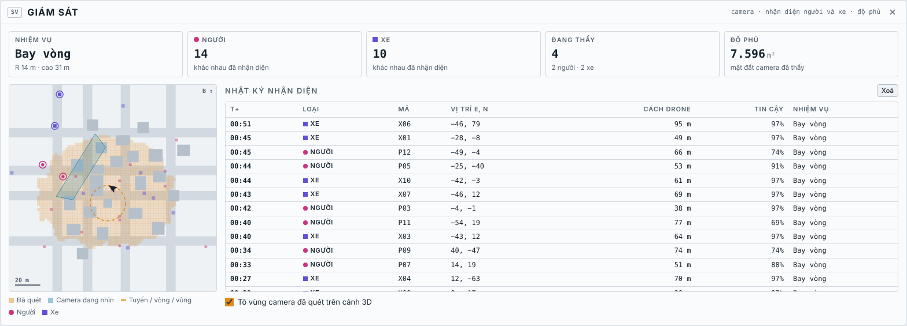
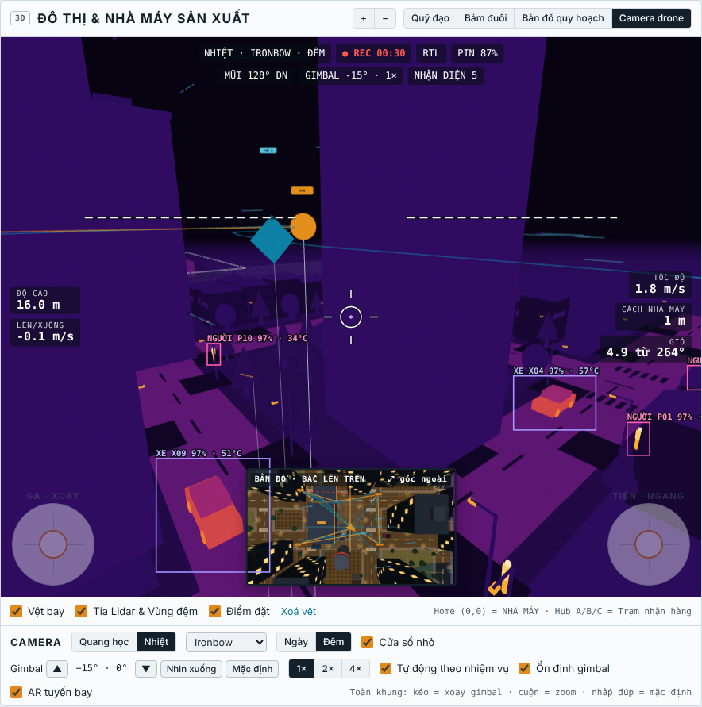
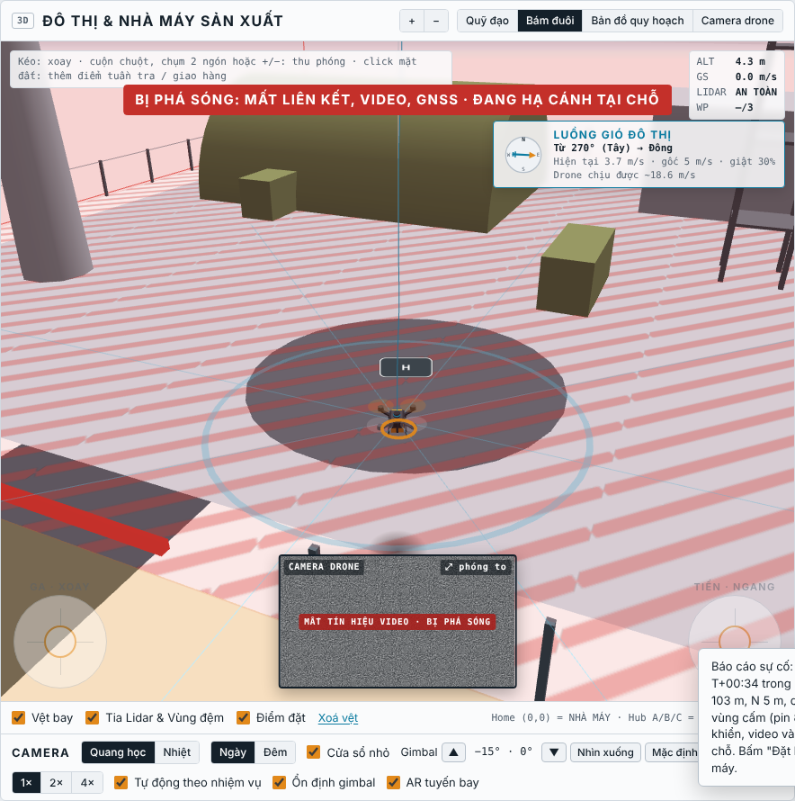
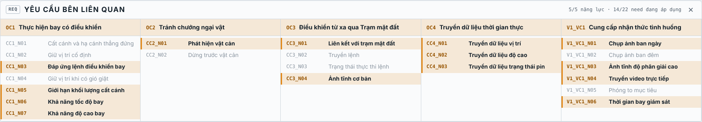
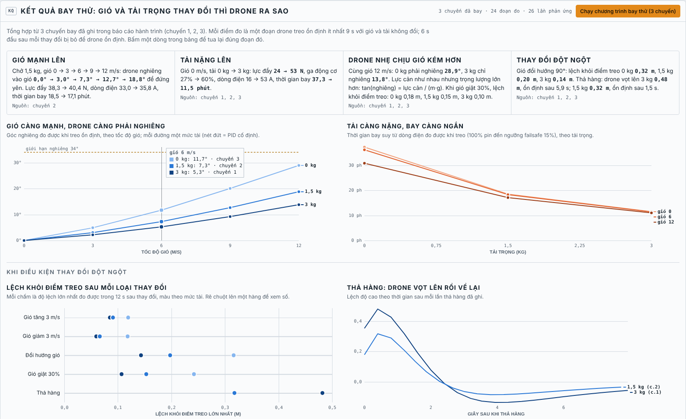
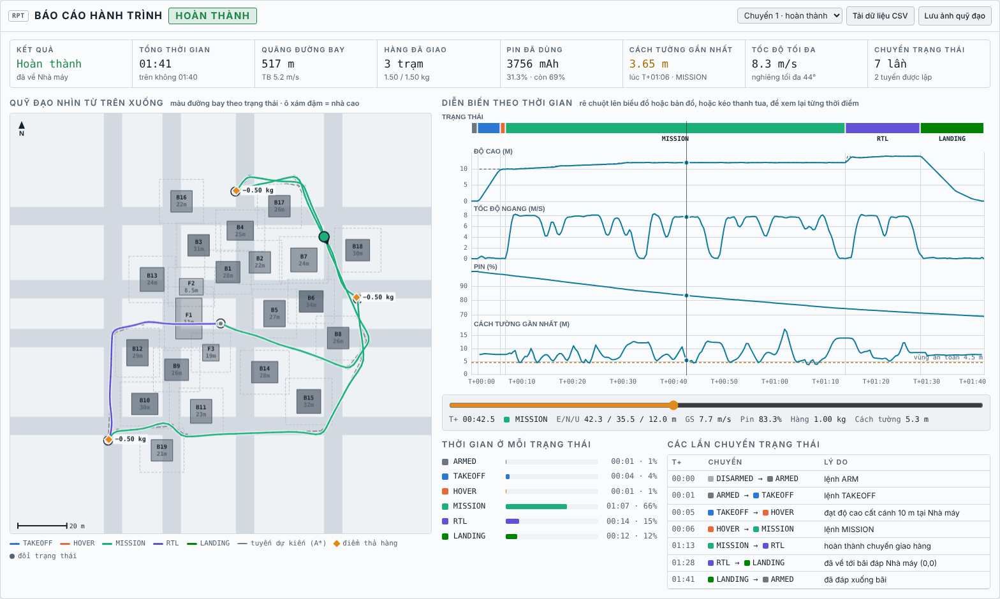
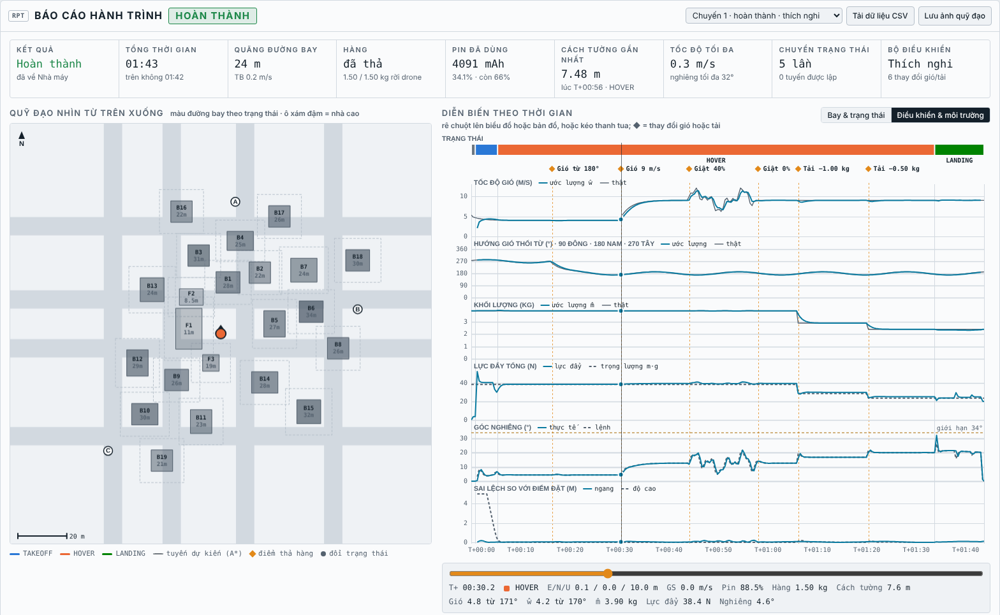

# Urban Surveillance Drone Sim

Mô phỏng drone giám sát đô thị, chạy hoàn toàn trên trình duyệt. Drone cất cánh từ bãi đáp của Nhà Máy Sản Xuất, mang camera gimbal để tuần tra theo tuyến, bay vòng quanh một mục tiêu hoặc quét một khu vực. Camera nhận diện người và xe trong thành phố. Drone vẫn giữ chức năng chở hàng: mang kiện hàng tới các trạm Hub A, B, C và tự thả. Bạn điều khiển drone bằng lệnh, bàn phím hoặc cần ảo, và theo dõi mọi thứ qua dashboard và cảnh 3D.

**Chạy thử:** https://huy-htg.github.io/Drone/



## Các phần của giao diện

| Phần | Nội dung |
|---|---|
| **Chức năng** (Điều hành nhiệm vụ) | Lệnh ARM, DISARM, TAKEOFF, LAND, HOLD, MANUAL, MISSION, RTL, KILL. Chọn nhiệm vụ giám sát (tuần tra, bay vòng, quét vùng) hoặc giao hàng. Chỉnh khối lượng hàng, khoảng cách an toàn, tuyến bay (preset hoặc click mặt đất), tham số bay, gió và các tình huống lỗi. |
| **Giám sát** | Số người và xe đã nhận diện, số đang thấy, độ phủ mặt đất; bản đồ giám sát (tòa nhà, tuyến, vùng camera đã quét, người, xe); nhật ký nhận diện. |
| **Máy trạng thái** | 10 trạng thái, sơ đồ tô sáng trạng thái hiện tại và lần chuyển gần nhất, danh sách lệnh hợp lệ, nhật ký sự kiện. |
| **Dashboard** | ALT, V/S, GS, HDG, khoảng cách về nhà máy, khoảng cách vật cản; chân trời nhân tạo, băng hướng mũi; pin 6S (điện áp, dòng, mAh, thời gian còn lại); RPM 4 động cơ; biểu đồ 30 giây; setpoint của bộ điều khiển. |
| **3D** (Three.js) | Khu đô thị có cao ốc, nhà máy, đường phố, cây và đèn đường; quỹ đạo giao hàng, điểm né, đường thẳng bị chắn (nét đứt đỏ), tuyến RTL (nét đứt xanh), tia Lidar, vùng đệm an toàn, vệt bay và luồng gió. Có 3 góc nhìn ngoài và góc nhìn **camera trên drone**; thu phóng bằng cuộn chuột, chụm 2 ngón, nút + / − hoặc phím + / −. Tòa nhà nằm giữa camera và drone tự làm mờ để không che drone. |

## Cách dùng

Mở `index.html` bằng trình duyệt (cần mạng để tải Three.js và font từ CDN). Không cần cài đặt hay build gì.

Cách nhanh nhất là bấm **Bắt đầu tuần tra** trong phần Nhiệm vụ giám sát: drone tự ARM → TAKEOFF → MISSION, bay hết tuyến tuần tra rồi RTL và hạ cánh. Để xem chức năng chở hàng, bấm **Chạy Demo Giao Hàng** ở phần Tuyến bay · Giao hàng.

| Phím | Tác dụng (khi ở HOVER hoặc MANUAL) |
|---|---|
| `W` `S` / `↑` `↓` | Tiến / lùi |
| `A` `D` / `←` `→` | Sang trái / phải |
| `Q` `E` | Xoay mũi |
| `R` `F` | Lên / xuống |

Đang HOVER mà chạm cần hoặc phím thì drone tự chuyển sang MANUAL. Buông cần thì drone phanh lại rồi giữ vị trí.

Hai phím sau dùng được ở mọi trạng thái:

| Phím | Tác dụng |
|---|---|
| `C` | Bật / tắt góc nhìn camera trên drone |
| `H` | Ẩn mọi bảng dashboard để chỉ xem 3D; bấm lại để hiện lại |
| `T` | Camera quang học ↔ camera nhiệt |
| `N` | Ngày ↔ đêm |

### Ẩn và hiện các bảng

Nút **Bảng** trên đầu trang mở danh sách các bảng: Điều hành nhiệm vụ, Telemetry, Giám sát, Máy trạng thái, Kết quả bay thử, Báo cáo hành trình. Bỏ chọn để ẩn, chọn để hiện lại. **Chỉ xem 3D** ẩn tất cả, khung 3D giãn ra toàn bộ chiều rộng. Mỗi bảng cũng có nút × ở góc tiêu đề. Trình duyệt nhớ lựa chọn cho lần mở sau.

Trong bảng Điều hành nhiệm vụ và bảng Telemetry, bấm tiêu đề một mục (ví dụ "Nhiệm vụ giám sát", "Thử phản ứng điều khiển", "Gió đô thị & giả lập sự cố", "Pin 6S") để ẩn hoặc hiện mục đó. Nút **Thu gọn hết / Mở hết** trên đầu mỗi bảng ẩn hoặc hiện tất cả các mục cùng lúc. Trình duyệt cũng nhớ các mục đã thu gọn.

Bảng bị ẩn mà bạn bấm liên kết tới nó (ví dụ "Kết quả gió & tải ↓", nút "Xem kết quả" khi bay thử xong) thì bảng tự hiện lại.

### Camera trên drone

Drone mang một camera gimbal treo dưới mũi. Người điều khiển xem được hình từ camera theo hai cách:

- **Cửa sổ nhỏ** ở giữa đáy khung 3D, hiện hình camera trong khi bạn xem drone từ bên ngoài. Bấm vào cửa sổ để phóng to.
- **Camera drone** (nút trên khung 3D hoặc phím `C`): hình camera chiếm toàn khung. Màn hình hiển thị đè lên hình (OSD) gồm REC và thời gian ghi, trạng thái, pin, hướng mũi, góc gimbal, độ cao, tốc độ lên/xuống, tốc độ, khoảng cách về nhà máy, gió, tâm ngắm và đường chân trời. Lúc này cửa sổ nhỏ chuyển thành bản đồ nhìn từ trên xuống (bắc lên trên) có mũi tên chỉ hướng drone. Bấm bản đồ để quay lại góc nhìn ngoài.

Điều khiển camera nằm ở hàng **Camera** dưới khung 3D:

- **Gimbal ▲ ▼** chỉnh góc ngẩng/chúc từ +20° đến −90°, mỗi lần 10°. **Nhìn xuống** chúc thẳng −90° để canh bãi thả hàng. **Mặc định** về −15°, hướng theo mũi, zoom 1×.
- **Zoom 1× 2× 4×**. Ở chế độ toàn khung còn có thể cuộn chuột hoặc chụm 2 ngón (1× đến 6×). Kéo chuột để xoay gimbal: kéo dọc để ngẩng/chúc, kéo ngang để quay trái/phải tới ±120°. Nhấp đúp để về mặc định.
- **Ổn định gimbal**: bật thì hình luôn cân bằng, chỉ quay theo hướng mũi. Tắt thì camera gắn cứng vào khung, hình nghiêng theo drone; khi gió mạnh sẽ thấy rõ drone phải nghiêng vào gió.
- **Tự động theo nhiệm vụ**: camera tự quét hai bên khi tuần tra, nhìn vào mục tiêu khi bay vòng, chúc thẳng xuống khi quét vùng và khi tới gần bãi thả hàng, hoặc bám người/xe bạn chọn. Chỉnh gimbal bằng tay thì chế độ này tự tắt.
- **AR tuyến bay**: vẽ tuyến bay, điểm giao hàng và vệt bay chồng lên hình camera.

Hình camera không có tia Lidar, vùng đệm hay thân drone. Tòa nhà luôn hiện đặc trong hình camera, kể cả khi đang được làm mờ ở góc nhìn ngoài.



## Nhiệm vụ giám sát

Chọn nhiệm vụ ở phần **Nhiệm vụ giám sát** (bảng Điều hành), chỉnh tham số rồi bấm **Bắt đầu**. Drone tự cất cánh nếu đang ở dưới đất, leo thẳng lên độ cao nhiệm vụ rồi mới bay ra, để không phải luồn giữa các xưởng. Xong nhiệm vụ thì drone làm theo lựa chọn "Khi xong" (mặc định RTL về Nhà máy). **Gọi về (RTL)** dừng nhiệm vụ bất cứ lúc nào.

| Nhiệm vụ | Cách bay | Camera |
|---|---|---|
| **Tuần tra** | Bay theo tuyến dọc các trục phố: Hàng rào Nhà máy, Trục phố trung tâm, Vòng ngoài khu đô thị, hoặc tự vẽ bằng cách click mặt đất. Chọn 1, 2, 3 vòng hoặc lặp liên tục tới khi gọi về. Drone bay xuyên qua các điểm, không dừng. | Chúc −32°, quét qua lại hai bên ±55°. |
| **Bay vòng** | Chọn một tòa nhà, một trạm Hub hoặc click một điểm trên bản đồ. Drone bay tới vòng, rồi bay tròn quanh mục tiêu theo bán kính, độ cao, tốc độ, chiều và số vòng đã chọn. Nếu vòng bay cắt qua tòa nhà khác thì độ cao vòng tự được nâng lên trên nóc tòa nhà đó 3 m. | Mũi drone luôn hướng vào mục tiêu, gimbal chúc đúng góc để mục tiêu nằm giữa khung hình. |
| **Quét vùng** | Chọn Khu Nhà máy, Khu phố Bắc, Khu phố Đông hoặc khoanh vùng bằng 2 click. Drone bay zig-zag theo các làn song song với cạnh dài; khoảng cách làn tính từ bề rộng vệt camera ở độ cao quét để hai vệt cạnh nhau chồng 30%. Độ cao mặc định cao hơn nóc nhà cao nhất trong vùng 3 m. | Chúc thẳng xuống. Ô đất được tính là đã quét khi nằm trong khung hình và cách ống kính dưới 45 m; độ phủ của vùng hiện theo %. |
| **Giao hàng** (phụ) | Như trước: chọn Hub A, B, C hoặc liên trạm, drone dừng ở từng trạm và thả phần hàng của trạm đó. | Chúc thẳng xuống khi cách bãi thả dưới 14 m. |

Trên tuyến tuần tra và vùng quét, drone vẫn mang theo kiện hàng (nếu có) nhưng không thả: chỉ các điểm giao hàng mới thả hàng.

### Nhận diện người và xe

Trong thành phố có 16 người đi bộ trên vỉa hè và 10 xe chạy trên các làn đường. Camera nhận diện một đối tượng khi đủ 3 điều kiện: đối tượng nằm trong khung hình, đủ lớn trên cảm biến 1920 × 1080 (người ít nhất khoảng 11 điểm ảnh, xe 9 điểm ảnh; zoom làm đối tượng lớn hơn nên thấy được xa hơn), và đường nhìn từ ống kính tới đối tượng không bị tòa nhà che. Độ tin cậy tăng theo kích thước trên ảnh.

Đối tượng được nhận diện có khung màu trong hình camera (cả toàn khung lẫn cửa sổ nhỏ) và vòng tròn trên bản đồ giám sát. Mỗi lần một đối tượng xuất hiện lại sau hơn 15 giây vắng mặt được ghi một dòng vào **Nhật ký nhận diện** (thời điểm, loại, mã, vị trí, khoảng cách, độ tin cậy, nhiệm vụ đang bay). Bấm một dòng để camera bám theo đối tượng đó; bấm lại hoặc **Bỏ bám** để thôi.



### Ban đêm và camera nhiệt (hồng ngoại)

Ở hàng **Camera** dưới khung 3D:

- **Ngày / Đêm** (phím `N`): ban đêm trời tối, cửa sổ và đèn đường sáng.
- **Quang học / Nhiệt** (phím `T`): đổi giữa camera quang học (ảnh màu) và camera nhiệt.
  - Camera nhiệt có hai bảng màu: **Trắng nóng** (vật càng nóng càng trắng) và **Ironbow** (lạnh tím đen → nóng vàng trắng).
  - Người (34–37 °C) và xe có động cơ, lốp nóng nổi bật trên nền tòa nhà và mặt đất nguội. Ban ngày mặt đường và tường bị nắng hâm nóng nên tương phản kém hơn ban đêm.
  - Khung nhận diện ghi kèm nhiệt độ ước lượng.

Cảm biến ảnh hưởng tới nhận diện:

| Cảm biến | Độ phân giải | Ngưỡng nhận diện (người / xe) | Ghi chú |
|---|---|---|---|
| Quang học, ban ngày | 1920 × 1080 | 11 / 9 điểm ảnh | Như trước |
| Quang học, ban đêm | 1920 × 1080 | 26 / 20 điểm ảnh | Ảnh tối và nhiễu, độ tin cậy giảm còn khoảng 60% |
| Nhiệt, ban ngày | 640 × 512 | 5,5 / 4,5 điểm ảnh | |
| Nhiệt, ban đêm | 640 × 512 | 4 / 3,5 điểm ảnh | Thấy xa nhất |

Nhật ký nhận diện có thêm cột **Cảm biến** (EO, EO đêm, IR). OSD ghi rõ đang dùng camera nào.



## Khu vực quân sự (vùng cấm bay)

Bản đồ được mở rộng về phía đông với **Căn cứ quân sự Đông** (E 100…160 m, N −40…40 m). Căn cứ có hàng rào, cổng, nhà chứa máy bay, doanh trại, tháp chỉ huy, radar quay, bãi trực thăng và trạm phá sóng có đèn đỏ nhấp nháy. Một con đường dẫn từ trục phố N 14 m tới cổng. Ranh giới vùng cấm là bức tường ảo màu đỏ cao 60 m trên cảnh 3D; bản đồ giám sát cũng vẽ vùng này.

| Tình huống | Drone | Người điều khiển nhận được |
|---|---|---|
| Còn 20 m tới ranh giới | Bay tiếp | Cảnh báo vàng trên khung 3D, dòng nhật ký |
| Vào trong vùng | Bị chặn: đang MISSION thì chuyển HOVER ngay ở ranh giới. Mọi lệnh bay sâu hơn bị cắt, chỉ bay ra được (lái tay, RTL…) | Cảnh báo đỏ đếm ngược tới lúc bị phá sóng, thông báo nổi, nhật ký |
| Còn 5 s | | Nhắc rời khu vực |
| Ở quá 10 s | **Bị phá sóng**: mất liên kết điều khiển, video và GNSS. Không định vị được để bay về nên FAILSAFE chuyển sang hạ cánh tại chỗ | **Báo cáo sự cố** (thời điểm, vị trí, độ cao, thời gian trong vùng, pin, hành động của drone). Hình camera chuyển sang nhiễu "MẤT TÍN HIỆU VIDEO". Bảng Giám sát hiện ô Sự cố và đánh dấu × chỗ bị phá sóng. Mọi lệnh sau đó bị từ chối cho tới khi bấm **Đặt lại** |

Nút **Bay thử vào khu quân sự** trong bảng Điều hành cho drone bay theo trục phố vào căn cứ để xem toàn bộ chuỗi trên. Có thể thử rời đi kịp: bấm RTL trong 10 s đầu.

Click mặt đất 3D trong căn cứ vẫn thêm được điểm vào tuyến; khi lập tuyến, nhật ký báo trước rằng drone sẽ bị chặn tại ranh giới.



## Yêu cầu của các bên liên quan (SCV)

Bảng **Yêu cầu bên liên quan** có một cột cho mỗi năng lực của dòng Surveillance Drone (Dòng Trinh sát; đã bỏ biến thể ném bom V2). Dưới mỗi năng lực là các mã need (Need ID) và tên need bằng tiếng Việt. Trong lúc vận hành, need nào đang được dùng thì dòng đó in đậm, nền cam, có vạch cam; need chưa dùng thì chữ nhạt. Tiêu đề năng lực đậm lên khi có ít nhất một need của nó đang dùng.

| Need ID | Tên | Đang áp dụng khi |
|---|---|---|
| CC1_N01 | Cất cánh và hạ cánh thẳng đứng | TAKEOFF hoặc LANDING |
| CC1_N02 | Giữ vị trí cố định | Đang treo (HOVER, hoặc dừng ở điểm giao) |
| CC1_N03 | Đáp ứng lệnh điều khiển bay | Bay theo lệnh: MANUAL, MISSION, RTL, FAILSAFE |
| CC1_N04 | Giữ vị trí khi có gió giật | Đang treo khi có gió |
| CC1_N05 | Giới hạn khối lượng cất cánh | Cất cánh, hoặc đang bay có chở hàng |
| CC1_N06 | Khả năng tốc độ bay | Tốc độ ngang trên 1 m/s |
| CC1_N07 | Khả năng độ cao bay | Đang bay trên 5 m |
| CC2_N01 | Phát hiện vật cản | Lidar thấy vật cản trong 15 m |
| CC2_N02 | Dừng trước vật cản | Lực đẩy APF đang tác động, hoặc đang bay qua điểm né A* |
| CC3_N01 | Liên kết với trạm mặt đất | Còn liên kết (không mất liên kết, không bị phá sóng) |
| CC3_N02 | Truyền lệnh | Trong 3 s sau khi gửi lệnh |
| CC3_N03 | Trạng thái thực thi lệnh | Trong 8 s sau khi lệnh được chấp nhận hoặc từ chối |
| CC3_N04 | Ảnh tĩnh cơ bản | Trong 8 s sau khi chụp ảnh |
| CC4_N01–N03 | Truyền dữ liệu vị trí / độ cao / trạng thái pin | Khi còn liên kết |
| V1_VC1_N01 | Chụp ảnh ban ngày | Camera bật, ban ngày |
| V1_VC1_N02 | Chụp ảnh ban đêm | Camera bật, ban đêm |
| V1_VC1_N03 | Ảnh tĩnh độ phân giải cao | Trong 8 s sau khi chụp ảnh 20MP |
| V1_VC1_N04 | Truyền video trực tiếp | Đang xem hình camera (toàn khung hoặc cửa sổ nhỏ) |
| V1_VC1_N05 | Phóng to mục tiêu | Zoom lớn hơn 1× |
| V1_VC1_N06 | Thời gian bay giám sát | Đang bay nhiệm vụ giám sát |

Ảnh chụp có dải thông tin (thời gian, GPS, độ cao, cảm biến, zoom) và nằm trong mục **Ảnh chụp** của bảng Giám sát. Bấm một ảnh để xem lớn và tải bản xem trước 1920 × 1280.



**Còn thiếu:** V1_VC1 yêu cầu nhiệm vụ kéo dài tối thiểu 60 phút. Với pin 6S 12 Ah và khung hiện tại, thời gian bay ước tính chỉ khoảng 37 phút khi không chở hàng và khoảng 19 phút khi chở 1,5 kg.

## Kết quả bay thử: gió và tải trọng thay đổi thì drone ra sao

Phần **Kết quả** (liên kết "Kết quả gió & tải ↓" ở đầu trang) **chỉ tổng hợp từ các chuyến bay đã ghi** trong báo cáo hành trình. Chưa bay thì phần này trống.

Bấm **Chạy chương trình bay thử** để drone bay thật trong khung 3D, 3 chuyến với tải 3 kg, 1,5 kg và 0 kg. Mỗi chuyến cất cánh, treo trên Nhà máy, rồi cứ 12 s đổi một điều kiện:

1. gió Tây 0 → 3 → 6 → 9 → 12 m/s;
2. giảm về 9 m/s;
3. đổi hướng sang gió Nam;
4. giật 30%, rồi hết giật;
5. thả toàn bộ hàng;
6. hạ cánh.

Trước mỗi chuyến drone được nạp hàng và thay pin đầy, và trong lúc bay thử hệ số xả pin tạm về ×1 như thật để pin không cạn giữa chừng. Nếu drone rời trạng thái treo ngoài kịch bản (pin yếu, va chạm, bạn chạm cần điều khiển…), chương trình dừng và báo lý do; kết quả chỉ gồm phần đã bay. Ở tốc độ 4× cả chương trình mất khoảng 2 phút, và kết quả hiện dần trong lúc bay. Các chuyến bạn tự bay cũng được tính, nếu có đoạn treo ổn định hoặc có thay đổi gió/tải lúc đang treo.

- **Đoạn đo ổn định:** drone treo (HOVER) với gió, giật, tải và bộ điều khiển không đổi. Bỏ 6 s đầu sau mỗi thay đổi, lấy trung bình phần còn lại: góc nghiêng, lực đẩy, ga động cơ, dòng điện. Thời gian bay được suy từ dòng điện đo.
- **Phản ứng:** mỗi lần gió, hướng, giật hoặc tải đổi lúc đang treo. Ghi độ lệch ngang và độ cao trong 12 s sau đó, cùng thời gian ổn định lại.
- **Nguồn:** mỗi điểm và mỗi kết luận ghi rõ lấy từ chuyến nào. Bấm một dòng trong bảng để mở chuyến đó trong báo cáo hành trình, đúng thời điểm đó.



Ví dụ kết quả của một lần chạy chương trình (điều khiển thích nghi):

| Khi… | Drone biểu hiện (đo trong chuyến bay) |
|---|---|
| Gió mạnh lên (chở 1,5 kg, 0 → 12 m/s) | nghiêng 0° → 3° → 7,3° → 12,7° → 18,8° để đứng yên; lực đẩy 38,3 → 40,4 N; dòng 33 → 36 A |
| Tải nặng lên (không gió, 0 → 3 kg) | lực đẩy 23,5 → 53 N; dòng 16 → 53 A; thời gian bay 37 → 11,5 phút |
| Drone nhẹ gặp gió 12 m/s | 0 kg nghiêng 28,9°, sát giới hạn 34°; 3 kg chỉ nghiêng 13,8° |
| Thả hàng | thả 3 kg vọt lên 0,48 m; thả 1,5 kg vọt lên 0,32 m |

Bỏ chọn **Bật điều khiển thích nghi** rồi chạy lại chương trình để có thêm các chuyến PID cố định. Phần Kết quả vẽ chúng bằng nét đứt để so sánh.

## Báo cáo hành trình

Mỗi chuyến bay được ghi lại tự động: bắt đầu khi ARM hoặc TAKEOFF, kết thúc khi drone hạ cánh, bị ngắt khẩn cấp hoặc tắt động cơ. Báo cáo nằm ở cuối trang. Nó cập nhật ngay trong lúc bay, và khi chuyến kết thúc thì hiện thông báo **Xem báo cáo**.



- **Tóm tắt:** kết quả, tổng thời gian và thời gian trên không, quãng đường, số trạm đã giao và số kg hàng, pin đã dùng, khoảng cách gần nhất tới tòa nhà (lúc nào, ở trạng thái nào), tốc độ và góc nghiêng tối đa.
- **Quỹ đạo nhìn từ trên xuống:** đường bay thực tế tô màu theo trạng thái, vẽ chồng lên tuyến A\* dự kiến (nét đứt) và vùng đệm an toàn quanh từng tòa nhà. Có đánh dấu các điểm đổi trạng thái, điểm thả hàng, và dấu X nếu va chạm.
- **Diễn biến theo thời gian:** dải trạng thái, cùng 4 biểu đồ chung trục thời gian: độ cao (kèm độ cao đặt), tốc độ ngang, pin, khoảng cách tới tòa nhà (kèm đường vùng an toàn).
- **Tua lại:** kéo thanh tua, rê chuột lên biểu đồ hoặc bản đồ, hoặc bấm một dòng trong bảng chuyển trạng thái để nhảy tới đúng thời điểm đó. Vị trí, hướng mũi và các thông số tại thời điểm ấy hiện ngay bên dưới.
- **Thời gian ở mỗi trạng thái** và **bảng các lần chuyển trạng thái** kèm lý do.
- Lưu được 8 chuyến gần nhất để so sánh. **Tải dữ liệu CSV** cho phép phân tích tiếp bằng Excel hoặc Python; **Lưu ảnh quỹ đạo** xuất bản đồ ra PNG.

## Điều khiển thích nghi theo gió và tải

Bộ điều khiển chỉ dùng những gì một flight controller thật có: lực đẩy, tư thế và gia tốc từ IMU. Ba nhóm tham số thay đổi trong lúc bay:

| Tham số | Loại | Thay đổi như thế nào |
|---|---|---|
| Khối lượng ước lượng m̂, lực đẩy treo m̂·g, ga treo | thích nghi | m̂ ← T·z_b / (a_z + g), lọc thông thấp τ = 1 s, bỏ qua khi đang leo/hạ nhanh. Thả hàng thì m̂ học lại sau khoảng 2–3 s. |
| Bù nhiễu gió d̂ và gió ước lượng ŵ | thích nghi | Bộ quan sát nhiễu d̂ = a_đo − z_b·T/m̂ (τ = 0,5 s), được bù trước vào lệnh gia tốc. Gió ŵ suy ngược từ mô hình lực cản. |
| Quán tính Î và hệ số tư thế hiệu dụng ηKp | lập lịch theo tải | Î = I₀ + (m̂ − 2,4)·0,11², vì kiện hàng treo dưới bụng làm tăng quán tính, nên băng thông vòng tư thế giữ nguyên. |
| Kp vị trí 1,05 · Kp vận tốc 2,5 · Kp/Kd tư thế 78/14 | cố định | Giống nhau với mọi tải và mọi cơn gió. |

Hệ quả nhìn thấy được: để giữ vị trí, drone nghiêng *vào* gió một góc tan θ = lực cản / (m·g). Cùng gió 9 m/s, drone chở 1,5 kg nghiêng khoảng 12,7°; thả hết hàng thì nghiêng khoảng 20°, vì lực cản như nhau mà trọng lượng nhỏ hơn. Gió đổi hướng thì góc nghiêng giữ nguyên độ lớn nhưng xoay theo hướng gió. Thời tiết đổi dần (τ = 2 s), không nhảy tức thì.

**Cách xem:**
- Mục **Thích nghi điều khiển** trên dashboard: la bàn gió thật, gió ước lượng và hướng nghiêng, kèm bảng tham số trực tiếp.
- Các nút **Gió đổi hướng +90°**, **Gió ±4 m/s**, **Thả 0,5 kg hàng** tạo thay đổi đột ngột lúc đang bay.
- **Chạy chương trình bay thử**: 3 chuyến bay thật (xem mục Kết quả bay thử ở trên).
- Báo cáo hành trình, tab **Điều khiển & môi trường**: gió thật và ước lượng, hướng gió, khối lượng thật và m̂, lực đẩy so với trọng lượng, góc nghiêng, sai lệch vị trí. Mỗi thay đổi được đánh dấu ◆, kèm bảng phản ứng: lệch tối đa, thời gian ổn định, góc nghiêng và lực đẩy trước → sau, thời gian bộ ước lượng hội tụ.
- Bỏ chọn **Bật điều khiển thích nghi** rồi chạy lại chương trình bay thử để so với PID cố định. Trong lần chạy thử, PID cố định lệch ngang gần gấp đôi (0,16 so với 0,09 m khi thả 1 kg; 0,36 so với 0,22 m khi gió giật), và m̂ đứng yên ở 3,9 kg dù khối lượng thật đã giảm.



## Mô hình

**Khung và lực đẩy.** Quad X khung 800 mm, tự trọng 2,4 kg, chở thêm tối đa 3 kg. 4 động cơ, mỗi chiếc tối đa 22 N, có độ trễ bậc nhất 40 ms. Lực cản không khí gồm thành phần tuyến tính và bậc hai theo vận tốc tương đối với gió. Mô men cản quay của cánh quạt tạo ra yaw.

**Điều khiển.** PID xếp tầng: vị trí → vận tốc → gia tốc → góc nghiêng và lực đẩy → bộ trộn 4 động cơ (có ưu tiên roll/pitch hơn yaw khi bão hòa). Góc nghiêng tối đa 34°. Vòng trong chạy 250 Hz. Bộ điều khiển không biết khối lượng và gió thật, mà tự ước lượng (xem mục *Điều khiển thích nghi*).

**Dẫn đường.** Drone bám theo từng chặng thẳng giữa hai điểm, có hiệu chỉnh lệch ngang và lịch tốc độ: giảm tốc trước mỗi khúc cua sao cho thành phần vận tốc vuông góc với chặng mới, `v·sinθ`, triệt tiêu được trong khoảng 1 m với gia tốc 3 m/s². Tới trạm thì dừng hẳn, treo khoảng 2 giây để thả hàng. Với tuyến liên trạm, hàng được chia đều cho các trạm.

**Lập quỹ đạo né cao ốc (A\*).** Lưới 2 m phủ ±84 m. Chỉ những tòa nhà cao hơn độ cao bay mới được tính là vật cản. Ô cách mặt tường dưới 1,6 m bị cấm. Ô nằm trong khoảng cách an toàn vẫn đi được nhưng chịu phạt nặng, nên tuyến bay bám giữa lòng đường mà vẫn tới được trạm nằm sát tòa nhà. Sau đó thuật toán cắt bớt điểm theo tầm nhìn thẳng (line-of-sight), với điều kiện đường tắt không được đi sát tường hơn chính đường lưới ban đầu. Nếu bị vây kín, drone leo thẳng lên trên tòa cao nhất, bay ngang qua rồi hạ xuống.

**Lidar và APF.** 8 tia Lidar quét 360° để hiển thị. Trường lực đẩy APF tạo vận tốc đẩy ra xa mặt tường: khoảng 0,6 m/s ở mép vùng đệm và 3,3 m/s khi còn cách 1,5 m (tối đa 4,5 m/s). APF hoạt động ở mọi chế độ bay, kể cả MANUAL.

**Pin.** 6S 12000 mAh. Dòng điện tính theo lực đẩy từng động cơ, điện áp theo đường cong xả và nội trở. Có thể tăng hệ số xả pin để thấy nhanh các mốc cảnh báo 25% và failsafe 15%.

**Gió.** Gió nền cộng giật, hướng dao động ±12°. Drone chỉ giữ được vị trí trước gió tới khoảng **13,6 m/s khi không chở hàng** (khoảng 18,6 m/s khi chở 1,5 kg), lúc lực cản cân bằng với lực ngang ở góc nghiêng tối đa. Bảng gió trên khung 3D hiển thị giới hạn này và chuyển sang đỏ khi gió giật vượt quá.

## Máy trạng thái

| Trạng thái | Ý nghĩa | Chuyển đi khi |
|---|---|---|
| DISARMED | Động cơ tắt | ARM |
| ARMED | Quay không tải trên đất | TAKEOFF, DISARM, tự DISARM sau 12 s |
| TAKEOFF | Leo thẳng tới độ cao cất cánh | đạt độ cao → HOVER |
| HOVER | Giữ vị trí E/N/U và hướng mũi | MANUAL / chạm cần, MISSION, RTL, LAND |
| MANUAL | Lái tay, có APF bảo vệ | HOLD, MISSION, RTL, LAND |
| MISSION | Bay theo quỹ đạo A\* tới các trạm | giao xong → RTL / HOVER / LAND (tùy chọn) |
| RTL | Leo tới độ cao RTL, theo tuyến né cao ốc về nhà máy | tới bãi đáp → LANDING |
| LANDING | Hạ cánh, tốc độ giảm dần | chạm đất 0,4 s → ARMED |
| FAILSAFE | Pin dưới 15% hoặc mất liên kết: tự về nhà máy | tới nơi → LANDING; pin dưới 6% → hạ cánh tại chỗ |
| EMERGENCY | KILL, va chạm hoặc hết pin: ngắt động cơ | nằm yên trên đất → DISARMED |

Nếu bấm HOLD giữa tuyến rồi MISSION lại, drone lập lại quỹ đạo từ vị trí hiện tại và bay tiếp tới trạm chưa giao.

## Kiểm thử

Lõi mô phỏng không phụ thuộc DOM, nên có thể chạy bằng Node:

```bash
node tests/run-scenarios.js
```

Bộ kiểm thử bay vào khu quân sự (cảnh báo, chặn ở ranh giới, phá sóng đúng 10 s rồi hạ cánh tại chỗ, rời đi kịp thì không bị phá sóng), bay 3 tuyến tuần tra (mỗi tuyến 2 vòng), bay vòng quanh cao ốc (bám bán kính, mũi hướng vào mục tiêu, tự nâng độ cao), quét 3 khu vực (các làn phủ kín bề ngang), các tuyến Hub A, B, C và liên trạm, bay ở tốc độ 14 m/s, thử HOLD rồi bay tiếp, mất liên kết, chia hàng, 200 điểm click ngẫu nhiên và bay trên mọi nóc nhà, bay chương trình bay thử rồi kiểm tra xu hướng gió × tải rút ra từ dữ liệu đã ghi, và kiểm tra điều khiển thích nghi: góc nghiêng giữ vị trí khớp lý thuyết, m̂ hội tụ sau mỗi lần thả hàng, giữ vị trí tốt hơn PID cố định. Kết quả là PASS/FAIL cho từng mục; mã thoát khác 0 nếu có mục thất bại.

## Giới hạn của mô hình

- Tòa nhà là hộp chữ nhật thẳng trục (2,5D). Silo được vẽ hình trụ nhưng va chạm tính theo hộp.
- Nhà thấp tầng, cây và đèn đường chỉ là cảnh, không tính va chạm. Vì vậy độ cao bay tối thiểu là 8 m, cao hơn tất cả các vật này.
- Gió đồng đều trong không gian, không có hiệu ứng xoáy sau tòa nhà. Khi gió giật vượt giới hạn ở trên, drone bị đẩy lệch khỏi tuyến và có thể va chạm. Đây là giới hạn vật lý của khung, không phải lỗi.
- Ngưỡng failsafe pin cố định 15%. Với hệ số xả pin rất cao (×15 trở lên), lượng pin dự trữ có thể không đủ để hạ cánh.
- Lidar lý tưởng, không có nhiễu. Khi hạ cánh khẩn cấp, drone chỉ đáp xuống mặt đất, không đáp lên nóc nhà.
- Ảnh nhiệt gán nhiệt độ theo loại vật thể (người, xe, mặt đường, tường…), không mô phỏng truyền nhiệt hay bức xạ thật.
- Phá sóng được mô phỏng theo luật: đúng 10 s trong vùng cấm thì mất liên kết. Không mô phỏng công suất phát, khoảng cách hay tần số.
- Nhận diện người và xe là mô hình hình học (khung hình, kích thước điểm ảnh, đường nhìn bị tòa nhà che), không phải mạng nơ-ron xử lý ảnh. Cây và nhà thấp tầng không che tầm nhìn. Người và xe đi theo đường thẳng trên vỉa hè và làn đường, không rẽ ở giao lộ.

## Cấu trúc

```
index.html               Toàn bộ ứng dụng: HTML, CSS, lõi lập nhiệm vụ giám sát (script#surv-core), lõi mô phỏng (script#sim-core) và giao diện
tests/run-scenarios.js   Kiểm thử lõi mô phỏng bằng Node
docs/                    Ảnh chụp màn hình (giao diện, camera trên drone, camera nhiệt, phá sóng, bảng giám sát, kết quả gió × tải, báo cáo hành trình, điều khiển thích nghi)
```

## Giấy phép

MIT. Xem [LICENSE](LICENSE).
